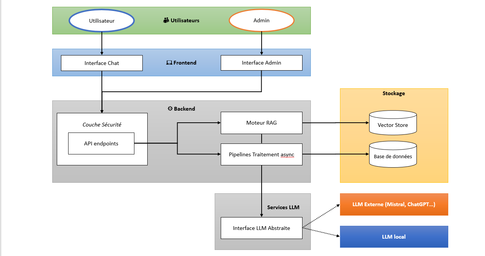

# Mimir - Chatbot Documentaire d'Entreprise


Mimir est une solution de chatbot intelligent RAG (Retrieval Augmented Generation) destinée aux entreprises, permettant aux employés d'obtenir des réponses instantanées et fiables basées exclusivement sur la documentation interne. 

## 🎬 Démonstration

https://github.com/user-attachments/assets/7efeac4d-fe0b-488f-823c-e28b7014a8f2

## ✨ Fonctionnalités

### Module Chat
- Interface web de conversation en langage naturel
- Historique de session temps réel
- Citation des sources pour chaque réponse
- Indicateur visuel pendant la génération
- Bouton d'escalade vers opérateur humain
- Score de confiance affiché pour chaque réponse

### Module Administration
- Authentification sécurisée (JWT)
- Upload manuel de documents (PDF, DOCX, TXT, MD)
- Liste et gestion des documents indexés
- Nettoyage automatique des chunks orphelins (rebuild index)
- Test de l'email d'escalade (SMTP configuré par variables d'environnement)
- Changement du mot de passe admin
- Indicateurs de santé système en temps réel
- Tableau de bord avec métriques d'utilisation
- Suivi des coûts IA : plafond budgétaire quotidien + dépense par modèle

### Module Ingestion
- Extraction de texte multi-format
- Chunking intelligent avec overlap
- Génération d'embeddings (Mistral API)
- Indexation vectorielle (FAISS)
- Queue séquentielle anti-saturation
- Protection documents critiques
- Traitement asynchrone avec retry logic
- Nettoyage automatique des chunks orphelins

### Module RAG
- Recherche hybride BM25 + dense avec fusion RRF (repli dense-only)
- Chunking structure-aware (titres de section) mesuré via RAGAS
- Citations vérifiables : marqueurs `[N]` cliquables ouvrant la source
- Scoring multi-critères (pertinence + boost nom de fichier)
- Contexte limité à la documentation, pas d'hallucination ("je ne sais pas" si incertitude)
- Filtrage dynamique des sources + cache intelligent des réponses

## 🏗️ Architecture



### Stack Technologique

#### Backend
- **Framework** : Python 3.13+, FastAPI, Uvicorn
- **Base de données** : SQLite (mode WAL)
- **Index** : FAISS (vectoriel, local) + BM25 (lexical, bm25s)
- **LLM** : Mistral API (mistral-small-latest, embeddings mistral-embed)
- **Cache** : LRU cache thread-safe avec TTL
- **Email** : aiosmtplib pour escalades
- **Auth** : JWT (PyJWT), mots de passe hachés en Argon2 (pwdlib), bcrypt accepté en vérification

#### Frontend
- **Framework** : React 18 avec hooks
- **Build** : Vite 8
- **UI** : Tailwind CSS
- **HTTP** : Axios avec intercepteurs, `fetch` pour le streaming SSE
- **Routing** : React Router v6

#### Infrastructure
- **Logs** : Système centralisé JSON structuré
- **Déploiement** : Docker Compose (backend non-root + frontend nginx)

### Architecture Modulaire

```
backend/
├── alembic.ini                # Migrations Alembic
└── mimir/
    ├── main.py                # Point d'entrée FastAPI
    ├── api/
    │   ├── endpoints/         # Routes REST (chat, documents, admin, auth, health, logs)
    │   ├── middleware/        # CORS, rate limiting
    │   ├── responses.py       # Réponses HTTP partagées (429 budget)
    │   └── dependencies.py    # Injection de dépendances
    ├── auth/                  # JWT, password utils, middleware
    ├── cache/                 # LRU cache services
    ├── config.py              # Configuration Pydantic centralisée
    ├── cost/                  # Plafond budgétaire IA, grille de prix, suivi d'usage
    ├── database/
    │   ├── models.py          # Modèles ORM SQLAlchemy
    │   ├── repository.py      # Pattern Repository
    │   ├── connection.py      # Gestion connexions DB
    │   └── migrations/        # Migrations Alembic
    ├── email_service/         # Service SMTP pour escalades
    ├── ingestion/
    │   ├── processor.py       # Pipeline d'ingestion
    │   ├── extractors.py      # Extraction multi-format
    │   ├── chunking.py        # Stratégie de découpage
    │   └── async_queue_manager.py  # Queue asynchrone
    ├── llm_interface/
    │   ├── interfaces.py      # Abstractions LLM
    │   └── implementations/mistral_api.py
    ├── rag_core/
    │   ├── interfaces.py      # Abstractions Vector Store, protocole LexicalIndex
    │   ├── fusion.py          # Reciprocal Rank Fusion
    │   ├── tokenizer_fr.py    # Tokenizer BM25
    │   └── implementations/   # faiss_store.py, bm25_store.py, validation_utils.py
    ├── security/              # Mot de passe admin, contrôle des secrets au démarrage
    ├── services/              # Logique des routes : pipeline RAG, flux SSE, upload, suppression, maintenance des index
    ├── monitoring/            # Logging centralisé JSON, alertes SMTP
    ├── shared/                # Modèles Pydantic, constantes, exceptions métier (errors.py)
    └── utils/                 # Lecture des fichiers de logs

frontend/
├── src/
│   ├── components/
│   │   ├── Chat/              # Interface de conversation
│   │   ├── Admin/             # Tableau de bord admin
│   │   └── Common/            # Composants réutilisables
│   ├── services/
│   │   └── api.js             # Client API centralisé
│   ├── hooks/                 # Hooks personnalisés (useAuth, useDocumentsList)
│   ├── utils/                 # Utilitaires (storage, logger, auth)
│   └── test/                  # Tests vitest
└── package.json

tests/                         # Suite pytest (lancée depuis la racine)
├── unit/                      # Tests unitaires
├── integration/               # Tests d'intégration
├── oracle/                    # Tests de caractérisation (instantanés)
└── performance/               # Tests de performance

scripts/                       # Sauvegarde SQLite, CI locale, évaluation RAGAS (ragas_eval/)
docs/adr/                      # Décisions d'architecture
```

### Décisions d'architecture

Les choix structurants sont décrits dans [docs/adr/](docs/adr/README.md) :
- [0001](docs/adr/0001-budget-ia-par-reservation.md) : plafond quotidien de dépense IA par réservation ;
- [0002](docs/adr/0002-recherche-hybride-bm25-rrf.md) : recherche hybride BM25 + dense avec fusion RRF ;
- [0003](docs/adr/0003-evaluation-ragas.md) : évaluation RAG hors ligne avec RAGAS ;
- [0004](docs/adr/0004-sqlite-wal-et-faiss-local.md) : SQLite en mode WAL et index FAISS local ;
- [0005](docs/adr/0005-streaming-sse.md) : réponses du chat en streaming SSE.

### Taille du code

Lignes de code mesurées avec pygount 3.2.0 (hors commentaires et lignes vides) :

| Périmètre | Fichiers | Lignes de code |
| --- | ---: | ---: |
| Backend : `backend/mimir`, `scripts` (Python) | 88 | 9 007 |
| Frontend : `frontend/src` hors tests (JSX, JS, CSS) | 42 | 5 141 |
| **Code applicatif** | **130** | **14 148** |
| Tests backend : `tests/` (Python) | 85 | 12 119 |
| Tests frontend : `frontend/src/test/`, `*.test.jsx` | 16 | 1 475 |
| **Tests** | **101** | **13 594** |
| Outillage : `scripts/` (Python, Bash) | 16 | 1 963 |

```bash
pygount --format=summary --suffix=py backend/mimir scripts
pygount --format=summary --merge-embedded-languages --folders-to-skip='...,test' \
  --names-to-skip='...,*.test.js,*.test.jsx' frontend/src
pygount --format=summary --suffix=py tests
pygount --format=summary --merge-embedded-languages frontend/src/test \
  frontend/src/components/Admin/AnalyticsPanel.budget.test.jsx
pygount --format=summary --suffix=py,sh scripts
```

## 🚀 Installation et Déploiement

### Prérequis
- Python 3.13+
- Node.js 22 (Vite 8 exige Node.js 20.19+ ou 22.12+)
- Clé API Mistral
- Minimum 4GB RAM

### Installation locale

#### 1. Backend

```bash
cd backend

# Créer un environnement virtuel
python -m venv venv
source venv/bin/activate  # Linux/Mac
# ou venv\Scripts\activate  # Windows

# Installer les dépendances (runtime, tests et outils ; fichiers à la racine du projet)
pip install -r ../requirements-dev.txt
# ou, versions et hachages figés :
# pip install --require-hashes -r ../requirements-dev.lock
# Installer le package mimir en mode éditable
pip install --no-deps -e ..

# Créer le fichier .env
cp .env.example .env
# Éditer .env : MISTRAL_API_KEY, JWT_SECRET_KEY et le mot de passe admin (voir Configuration)

# Lancer le serveur
uvicorn mimir.main:app --reload --host 0.0.0.0 --port 8000
```

#### 2. Frontend

```bash
cd frontend

# Installer les dépendances
npm install

# Lancer le serveur de développement
npm run dev
```

L'application sera accessible sur :
- Frontend : http://localhost:3000
- Backend API : http://localhost:8000
- Documentation API : http://localhost:8000/docs

### Déploiement Docker Compose (production)

```bash
# Backend non-root + frontend statique nginx (proxy SSE), worker unique, volume data nommé
docker compose up -d --build
```

Le backend lit le fichier `.env` de son répertoire de travail (`backend/` avec `start-servers.sh`) ; toute clé inconnue bloque le démarrage. Modèle complet : `backend/.env.example`. Renseigner `JWT_SECRET_KEY`, `MISTRAL_API_KEY` et le mot de passe admin (`ADMIN_PASSWORD`) avant le premier démarrage, avec `ENVIRONMENT=production` : le backend refuse alors de démarrer si `JWT_SECRET_KEY` ou le mot de passe admin n'ont pas été changés.

## ⚙️ Configuration

### Variables d'environnement principales

```bash
# API Configuration
API_VERSION=v1
API_HOST=0.0.0.0
API_PORT=8000

# Database
DATABASE_URL=sqlite:///./data/sqlite/mimir.db
SQLITE_WAL_MODE=true

# LLM (Mistral)
MISTRAL_API_KEY=your_mistral_api_key_here
MISTRAL_MODEL=mistral-small-latest
MISTRAL_EMBEDDING_MODEL=mistral-embed

# Vector Store (FAISS)
FAISS_INDEX_PATH=./data/faiss/index.bin
FAISS_METADATA_PATH=./data/faiss/metadata.json
EMBEDDING_DIMENSION=1024
SIMILARITY_THRESHOLD=0.5
MAX_SOURCES=5

# Ingestion
MAX_CHUNK_SIZE=1000
CHUNK_OVERLAP=200
MAX_FILE_SIZE_MB=100

# Email (pour escalades)
SMTP_HOST=smtp.example.com
SMTP_PORT=587
SMTP_USER=your_email@example.com
SMTP_PASSWORD=your_smtp_password
ESCALATION_EMAIL=support@example.com

# Security
JWT_SECRET_KEY=change_me_to_a_long_random_secret
JWT_ALGORITHM=HS256
JWT_EXPIRATION_HOURS=2
# Mot de passe admin : définir l'un des deux (voir « Mot de passe admin »)
# ADMIN_PASSWORD=un_mot_de_passe_robuste
ADMIN_PASSWORD_HASH=your_argon2_hash_here

# Rate Limiting (requêtes par minute et par client)
RATE_LIMIT_ENABLED=true
RATE_LIMIT_LOGIN_PER_MINUTE=5
RATE_LIMIT_CHAT_PER_MINUTE=20
RATE_LIMIT_UPLOAD_PER_MINUTE=10

# Environment & Logging
ENVIRONMENT=development
LOG_LEVEL=INFO
```

### Mot de passe admin

L'unique compte d'administration s'appelle `admin`. Son mot de passe se définit de l'une de ces façons :

1. **`ADMIN_PASSWORD`** (variable d'environnement ou `.env`) : le mot de passe en clair, haché au démarrage en mémoire seulement, prioritaire sur `ADMIN_PASSWORD_HASH`. Il doit respecter les règles de robustesse (8 caractères minimum, une majuscule, une minuscule, un chiffre, un caractère spécial) ; en production, un mot de passe trop faible bloque le démarrage. C'est la méthode à utiliser en conteneur.
2. **`ADMIN_PASSWORD_HASH`** : un hash Argon2, généré par la commande ci-dessous.
3. **Interface Admin > Configuration** (mot de passe actuel requis) : le nouveau hash est écrit dans `ADMIN_PASSWORD_HASH` du fichier `backend/.env`, qui doit donc exister et être modifiable (ce n'est pas le cas dans l'image Docker). Si `ADMIN_PASSWORD` est défini, il reprend la main au redémarrage suivant.

Sans `ADMIN_PASSWORD` ni `ADMIN_PASSWORD_HASH`, le backend utilise un hash intégré au code source, donc public : il refuse de démarrer en production (`ENVIRONMENT=production`) et journalise un avertissement dans les autres environnements.

### Génération du hash admin

```bash
cd backend
python -c "from mimir.auth.jwt_handler import JWTHandler; print(JWTHandler().hash_password('votre_password'))"
```

## 📚 Utilisation

### 1. Connexion Admin

Accédez à l'interface admin via http://localhost:3000/admin et connectez-vous avec l'utilisateur `admin` et le mot de passe défini à l'installation (voir [Mot de passe admin](#mot-de-passe-admin)).

### 2. Upload de Documents

**Upload manuel :**
- Naviguez vers "Documents" dans l'admin
- Cliquez sur "Upload Document"
- Sélectionnez vos fichiers (PDF, DOCX, TXT, MD)


### 3. Chat avec le Bot

- Accédez à l'interface de chat
- Posez vos questions en langage naturel
- Consultez les sources citées pour chaque réponse
- Utilisez le bouton d'escalade si nécessaire

### 4. Monitoring

- Tableau de bord admin pour métriques en temps réel
- Health check : `/api/v1/health/`
- Logs système : `backend/logs/`

## 🧪 Tests

```bash
# Depuis la racine du dépôt : tous les tests (unit + integration + oracle + performance)
python -m pytest

# Tests unitaires uniquement
python -m pytest tests/unit/ -v

# Tests d'intégration
python -m pytest tests/integration/ -v

# Tests de caractérisation (contrat OpenAPI, JSON, flux SSE, classement, ingestion)
python -m pytest tests/oracle/ -v

# Tests de performance
python -m pytest tests/performance/ -v

# Frontend
cd frontend && npx vitest run
```

La couverture de `backend/mimir` est calculée à chaque exécution de pytest (rapport HTML dans `coverage_report/`).

La suite compte 911 tests pytest (720 unitaires, 147 d'intégration, 32 de caractérisation, 12 de performance ; couverture de `backend/mimir` : 92,17 %, seuil bloquant à 85 % dans `pytest.ini`) et 148 tests vitest (15 fichiers). Elle couvre : auth, cache, database, API endpoints, ingestion, RAG core, coûts IA et performance. Toute la suite tourne sur des chemins de données temporaires, jamais sur `backend/data/`.

Les tests de caractérisation (`tests/oracle/`) figent le comportement observable dans des instantanés JSON : contrat OpenAPI, réponses JSON, événements SSE, classement de la recherche et découpage en chunks. Ils se régénèrent avec `ORACLE_UPDATE=1 pytest tests/oracle`, uniquement pour un changement de comportement voulu, en relisant le diff.

## 🔍 Qualité et CI

- **Lint et format** : ruff (`ruff check .`, `ruff format --check .`), configuré dans `pyproject.toml` (règles F, E9, B, SIM, UP, BLE, C90, TID, I, RUF ; imports absolus uniquement ; complexité cyclomatique maximale 15). ESLint côté frontend.
- **Typage** : mypy sur `backend/mimir` avec `disallow_untyped_defs` et `check_untyped_defs` (`mypy backend/mimir`), sans erreur.
- **Tests** : pytest 9 (pytest-asyncio, pytest-cov ; une DeprecationWarning levée depuis `mimir` ou `tests` fait échouer la suite), vitest 5 côté frontend.
- **Vulnérabilités** : pip-audit sur `requirements-dev.lock` et `requirements.lock`, sans exclusion ; `npm audit` sur les dépendances de production du frontend (niveau haut).
- **Mesures ponctuelles** : radon (complexité), pygount (lignes de code), mutmut (tests de mutation de `rag_core/fusion.py`, `ingestion/chunking.py` et `rag_core/tokenizer_fr.py`, configuré dans `pyproject.toml`).

`bash scripts/local_ci.sh` enchaîne ruff, mypy, pytest et pip-audit (outils installés depuis `requirements-dev.txt`).

La CI GitHub Actions (`.github/workflows/ci.yml`) tourne sur chaque pull request : quatre jobs Python ruff, mypy, pytest et pip-audit, installés depuis les lockfiles avec `pip install --require-hashes`, plus une vérification hors ligne que les lockfiles correspondent aux versions épinglées dans `requirements*.txt` ; un job frontend (Node 22, `npm ci`) enchaîne ESLint, vitest, le build et `npm audit --omit=dev --audit-level=high`.

**Dépendances**
- `requirements.txt` (runtime seul, installé dans l'image Docker) et `requirements-dev.txt` (runtime, tests et outils de qualité) restent la source.
- `requirements.lock` et `requirements-dev.lock` en sont dérivés (versions et hachages figés, résolution universelle pour Python 3.13). Les régénérer depuis la racine avec les commandes inscrites dans leur en-tête :

```bash
uv pip compile requirements.txt --universal --python-version 3.13 --generate-hashes -o requirements.lock
uv pip compile requirements-dev.txt --universal --python-version 3.13 --generate-hashes -o requirements-dev.lock
```

- Dependabot (`.github/dependabot.yml`) propose chaque semaine des mises à jour pip, npm (`frontend/`) et GitHub Actions. Pour pip, il ne modifie que les `requirements*.txt` : régénérer les deux lockfiles sur sa branche, sinon la vérification de la CI échoue.

## 🛠️ API Documentation

L'API REST complète est documentée via OpenAPI/Swagger (désactivé quand `ENVIRONMENT=production`) :

**Accès à la documentation :**
- Swagger UI : http://localhost:8000/docs
- ReDoc : http://localhost:8000/redoc

### Endpoints principaux

#### Chat
- `POST /api/v1/chat/stream` : Poser une question (réponse en streaming SSE)
- `POST /api/v1/chat/escalate` : Escalader vers support humain

#### Documents (Admin)
- `GET /api/v1/documents/` : Lister les documents
- `POST /api/v1/documents/upload` : Upload un document
- `GET /api/v1/documents/{id}` : Détails d'un document
- `DELETE /api/v1/documents/{id}` : Supprimer un document
- `POST /api/v1/documents/{id}/reprocess` : Retraiter un document
- `POST /api/v1/documents/maintenance/validate-consistency` : Comparer SQLite et FAISS

#### Admin
- `GET /api/v1/admin/system-info` : Infos système
- `GET /api/v1/admin/usage` : Dépense IA (jour, par modèle, vs plafond)
- `GET /api/v1/admin/cache/stats` : Statistiques cache
- `POST /api/v1/admin/cache/clear` : Vider le cache
- `POST /api/v1/admin/vector-store/rebuild` : **Rebuild index + nettoyage orphelins**
- `GET /api/v1/admin/audit-log` : Logs d'audit

#### Auth
- `POST /api/v1/auth/login` : Connexion admin
- `POST /api/v1/auth/refresh` : Rafraîchir le token
- `POST /api/v1/auth/change-password` : Changer le mot de passe admin

#### Health
- `GET /api/v1/health/live` : Liveness (processus seul)
- `GET /api/v1/health/ready` : Readiness (dépendances : DB, vector store, LLM)
- `GET /api/v1/health/` : Health check complet
- `GET /api/v1/health/database` : Santé de la BD
- `GET /api/v1/health/cache` : Santé du cache

## 📊 Performance

### Optimisations Implémentées
- Cache LRU avec TTL pour réponses chat
- Mode WAL SQLite pour concurrence
- Batch processing pour embeddings
- Index FAISS exact (IndexFlatL2), compacté au-delà de 25 % de vecteurs supprimés
- Index BM25 reconstruit une seule fois par lot d'ingestion
- **Nettoyage automatique des chunks orphelins**
- Scoring adaptatif avec boost nom de fichier
- Queue asynchrone séquentielle pour ingestion
- Retry logic avec backoff exponentiel

## 🔒 Sécurité

### Mesures Implémentées
- **Authentification** : JWT avec tokens signés
- **Passwords** : Hash Argon2 (pwdlib), bcrypt legacy rétrocompatible
- **Secrets** : fail-fast au démarrage en production si `JWT_SECRET_KEY` ou le mot de passe admin n'ont pas été changés
- **Rate Limiting** : par client sur le login, le chat et les uploads
- **CORS** : Configuré selon environnement
- **Validation** : Pydantic sur tous les inputs
- **Validation fichiers** : Sanitization des noms de fichiers uploadés
- **Isolation** : Déploiement sur infrastructure dédiée, backend non-root, seul nginx expose un port

### Conformité
- RGPD : Données en local uniquement
- Confidentialité : Données stockées en local (les requêtes LLM transitent par l'API Mistral)
- Audit trail : Logs d'actions admin complets

## 🐛 Troubleshooting

### Problèmes Courants

#### 1. Erreur de connexion à Mistral API

```bash
# Vérifier la clé API dans le fichier .env
grep MISTRAL_API_KEY backend/.env

# Tester manuellement
curl -H "Authorization: Bearer VOTRE_CLE" https://api.mistral.ai/v1/models
```

#### 2. Base de données verrouillée

```bash
# Vérifier le mode WAL
sqlite3 backend/data/sqlite/mimir.db "PRAGMA journal_mode;"

# Activer WAL si nécessaire
sqlite3 backend/data/sqlite/mimir.db "PRAGMA journal_mode=WAL;"
```

#### 3. Index FAISS corrompu

```bash
# Supprimer et reconstruire
rm backend/data/faiss/index.bin backend/data/faiss/metadata.json

# Retraiter tous les documents via l'admin
# Endpoint: POST /api/v1/documents/{id}/reprocess
```

#### 4. Cache plein

```bash
# Vider le cache via API
curl -X POST http://localhost:8000/api/v1/admin/cache/clear \
  -H "Authorization: Bearer $ADMIN_TOKEN"
```

#### 5. Chunks orphelins après suppression de documents

Les chunks orphelins sont des chunks vectoriels qui existent dans FAISS mais dont le document parent a été supprimé de la base de données. Ils peuvent causer l'apparition de résultats fantômes dans les recherches. Une suppression n'est écrite sur disque qu'à la prochaine écriture de l'index (ingestion, rebuild, compactage automatique) : si le backend redémarre entre-temps, les chunks du document supprimé réapparaissent jusqu'au prochain rebuild.

**Symptômes :**
- Documents supprimés qui apparaissent encore dans les résultats de recherche
- Messages d'erreur "Document not found" dans les logs

**Solution :**
```bash
# Via l'interface admin : bouton "Rebuild Index"
# Ou via API :
curl -X POST http://localhost:8000/api/v1/admin/vector-store/rebuild \
  -H "Authorization: Bearer $ADMIN_TOKEN"
```

Le rebuild effectue automatiquement :
- ✅ Sauvegarde horodatée de l'index FAISS
- ✅ Détection des chunks orphelins
- ✅ Marquage comme supprimés  
- ✅ Optimisation de l'index FAISS
- ✅ Suppression physique des chunks deleted
- ✅ Resynchronisation de l'index BM25 et vidage des caches

### Logs

```bash
# Backend logs (dossier logs/ du répertoire de lancement d'uvicorn)
tail -f backend/logs/app.log

# Frontend logs (envoyés au backend si VITE_LOG_TO_FILE=true)
tail -f backend/logs/frontend.log

# Filtrer par niveau
grep "ERROR" backend/logs/app.log
```


## 🤝 Contribution

Ce projet est libre.

### Standards de Code
- **Python** : ruff (lint et format), mypy, type hints, docstrings des API publiques
- **JavaScript** : ESLint
- **Commits** : Conventional Commits
- **Tests** : Couverture 92 % (backend, seuil 85 %) ; la CI (ruff, mypy, pytest, pip-audit, frontend) tourne sur chaque pull request
- **Décisions** : un ADR par décision d'architecture dans `docs/adr/`

## 📝 License MIT

## 👥 Contact

Si cette approche de l'ingénierie, où la technique sert une vision business claire, vous intéresse, je serais ravi d'en discuter.

Contact : 

📧 yann@pointud.fr 

📞 06 87 85 59 07

---
